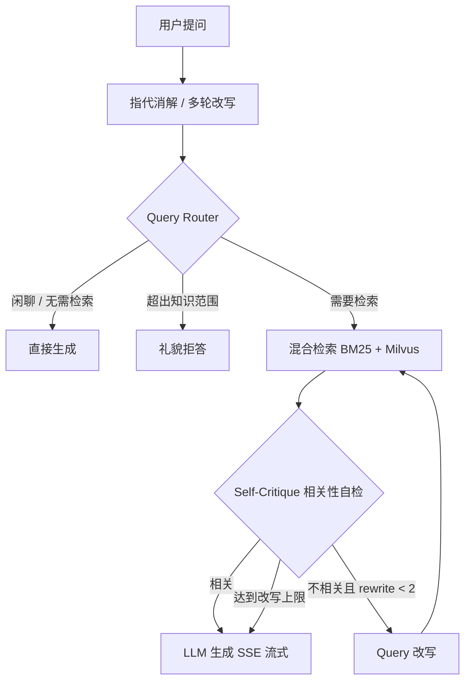
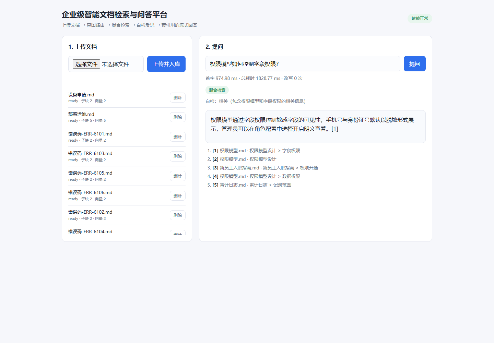

# 企业级智能文档检索与问答平台

[](https://github.com/ranyan666/enterprise-rag-platform/actions/workflows/ci.yml)

基于 RAG 架构的企业内部知识库问答平台：解析多格式业务文档并知识入库，结合大模型与私有数据回答业务咨询，缓解内部信息孤岛。

## 技术栈

- Python
- LangGraph（Agentic 编排）
- LangChain（ChatPromptTemplate + ChatOllama 流式生成）
- FastAPI
- Milvus
- Qwen 大模型
- BGE-M3 嵌入（Ollama 本地推理）
- jieba + rank_bm25（关键词检索）
- Redis

## 规划能力

- 多格式文档解析与知识入库
- BM25 关键词检索 + Milvus 稠密向量检索，RRF 融合双路召回
- 父子文档检索，兼顾上下文连贯性与答案准确性
- FastAPI 异步接口 + SSE 流式输出

## 快速开始

前置条件：Python 3.10、Docker Desktop、已启动的 Ollama 服务。

```powershell
# 1. 启动 Milvus / Redis 依赖
docker compose up -d

# 2. 拉取问答与嵌入模型（约 4.7G + 1.2G）
ollama pull qwen2.5:7b-instruct
ollama pull bge-m3

# 3. 安装依赖
python -m venv .venv
.\.venv\Scripts\python.exe -m pip install -e ".[dev]"

# 4. 可选：复制配置
Copy-Item .env.example .env

# 5. 启动服务
.\.venv\Scripts\python.exe -m uvicorn app.main:app --reload --port 8000

# 6. 验证依赖状态
Invoke-RestMethod http://127.0.0.1:8000/health
```

### Docker 容器化（可选）

应用镜像由仓库根目录 `Dockerfile` 构建，`docker-compose.yml` 里的 `app` 服务默认通过 profile 关闭，
不影响只起依赖的日常开发：

```powershell
# 容器内通过 host.docker.internal 访问宿主机 Ollama，需先让 Ollama 监听 0.0.0.0
$env:OLLAMA_HOST = "0.0.0.0"   # 设置后重启 Ollama 生效

docker compose --profile app up -d --build
Invoke-RestMethod http://127.0.0.1:8000/health
```

> 说明：`/health` 的 Docker 健康检查要求 `status=ok`；若容器无法访问宿主机 Ollama，会显示 unhealthy，
> 此时优先检查 `OLLAMA_HOST` 与 `host.docker.internal` 是否可达。

> **镜像拉取说明**
> - 国内网络无法访问 Docker Hub 时，可在 Docker Desktop 的 *Settings → Docker Engine* 中配置
>   `registry-mirrors`（例如 `https://docker.1ms.run`），保存后重启引擎。
> - MinIO 官方镜像已于 2025 年从 Docker Hub 下架，`docker-compose.yml` 因此改用 Bitnami 归档镜像
>   `bitnamilegacy/minio`（服务端仍是 MinIO，接口与凭证不变）。

> **模型下载慢时**：`bge-m3` 可从 ModelScope 下载同一份 GGUF（`gpustack/bge-m3-GGUF`，FP16 与
> Ollama 官方模型一致），再执行 `ollama create bge-m3 -f Modelfile`（Modelfile 内容为
> `FROM ./bge-m3-FP16.gguf`）离线导入。

接口文档：<http://127.0.0.1:8000/docs>

`GET /health` 返回 `status=ok` 表示 Milvus / Redis / Ollama 全部可达；任一依赖异常时为 `degraded`，并在 `dependencies[].detail` 中给出原因。接口本身始终返回 200，便于排障。

## 文档入库

支持 PDF / DOCX / Markdown / TXT，单文件默认上限 20 MB。上传后异步解析并做父子分块：
父块按标题层级与段落边界切分（默认 1800 字），子块在父块内滑窗切分（默认 400 字、重叠 80 字），
子块通过 `parent_id` 指回父块，检索命中后可用父块回填上下文。

| 方法 | 路径 | 说明 |
| --- | --- | --- |
| POST | `/api/v1/documents` | multipart 上传，返回 202 + 文档 id |
| GET | `/api/v1/documents` | 列表（`limit` / `offset` / `status`） |
| GET | `/api/v1/documents/{id}` | 详情（状态、块数、解析错误） |
| GET | `/api/v1/documents/{id}/chunks` | 分块查询（`level=parent\|child`） |
| DELETE | `/api/v1/documents/{id}` | 删除文档与磁盘文件 |

```powershell
$resp = curl.exe -s -X POST http://127.0.0.1:8000/api/v1/documents -F "file=@.tmp/sample.md"
$id = ($resp | ConvertFrom-Json).id
Invoke-RestMethod "http://127.0.0.1:8000/api/v1/documents/$id"
Invoke-RestMethod "http://127.0.0.1:8000/api/v1/documents/$id/chunks?level=child"
curl.exe -s -X DELETE "http://127.0.0.1:8000/api/v1/documents/$id"
```

状态机：`pending → processing → ready | failed`，失败原因写入 `error` 字段。
文件与元数据分别落在 `data/uploads/{id}/` 与 `data/app.sqlite3`，均已在 `.gitignore` 中。
已知限制：扫描件不做 OCR；DOCX 表格按行拍平为普通段落；PDF 标题识别依赖编号/章节样式，不还原复杂版式。

## 向量入库

子块解析完成后会调用本地 `bge-m3`（基于 Ollama，1024 维）生成向量，写入 Milvus collection
`document_chunks`（HNSW + COSINE，字段与 SQLite 子块一一对应）。父块不向量化，检索命中子块后
按 `parent_id` 回 SQLite 取完整上下文。

- 文档详情新增 `vector_count`，应等于 `child_count`
- `POST /api/v1/documents/{id}/reindex` 可重新解析并写入向量（嵌入失败、Milvus 恢复后使用）
- 删除文档会同时删除 SQLite 记录、磁盘文件与 Milvus 向量
- 嵌入/写向量失败时文档状态为 `failed`，错误原因写入 `error`，修复后调 `reindex` 即可
- collection 已存在但维度与 `EMBEDDING_DIM` 不一致时会拒绝写入并报错，避免写坏数据
- 更换嵌入模型时需同步修改 `EMBEDDING_MODEL`/`EMBEDDING_DIM` 并重建 collection

```powershell
# 重新索引（例如 Milvus 重启后）
Invoke-RestMethod -Method Post "http://127.0.0.1:8000/api/v1/documents/$id/reindex"
```

## 混合检索

`POST /api/v1/search` 同时跑两路召回，再用 RRF 融合，最后回填父块：

- **BM25 关键词**：jieba 搜索模式分词 + 停用词过滤，内存索引，按仓储指纹自动重建，只索引 ready 文档
- **稠密向量**：查询文本经 `bge-m3` 编码后在 Milvus 按 COSINE 检索
- **RRF 融合**：`score = Σ 1 / (k + rank)`，默认 `k=60`，避免两种分数量纲不可比
- **父块回填**：命中子块后按 `parent_id` 回 SQLite 取完整父段，`parent_text` 用于后续生成

```powershell
$body = @{ query = "权限模型包含哪些内容"; limit = 5 } | ConvertTo-Json
Invoke-RestMethod -Method Post http://127.0.0.1:8000/api/v1/search -Body $body -ContentType "application/json"
```

返回字段：`results[]`（`parent_text`/`child_text`/`score`/`bm25_rank`/`dense_rank`/来源文档）、
`timings`（两路召回与融合耗时）、`candidates`（各阶段候选数）。可调参数：
`RETRIEVAL_TOP_K`（每路召回数）、`RETRIEVAL_RESULT_LIMIT`（返回条数）、`RRF_K`。
接口支持单次覆盖 `top_k` / `limit`。BM25 索引为进程内缓存，暂不支持多 worker 部署。

## 问答（SSE）

`POST /api/v1/query` 先走混合检索，再把父块按 `[1] [2] …` 编号拼进 prompt，调用本地 Qwen 流式作答。
接口返回 `text/event-stream`，事件类型：

| 事件 | 数据 | 说明 |
| --- | --- | --- |
| `meta` | `query`、`citations[]`、`retrieval_ms`、`candidates` | 引用清单（文件名/章节/页码/分数）与检索耗时 |
| `token` | `text` | 增量文本，可多次 |
| `done` | `answer`、`citations[]`、`timings`、`eval_count` | 完整答案与 `retrieval_ms` / `ttft_ms` / `total_ms` |
| `error` | `message` | 检索或模型异常 |

```powershell
$json = '{"question":"权限模型包含什么","limit":5}'
[System.IO.File]::WriteAllText("$PWD\.tmp\q.json", $json, [System.Text.UTF8Encoding]::new($false))
curl.exe -N -X POST http://127.0.0.1:8000/api/v1/query -H "Content-Type: application/json" --data-binary "@$PWD\.tmp\q.json"
```

- prompt 使用 LangChain `ChatPromptTemplate` 管理，生成通过 `ChatOllama` 流式输出；
  `CHAT_BACKEND=langchain|http` 可在 LangChain 与原生 HTTP 客户端之间切换
- 只在“提示词 + 模型客户端”这一层使用 LangChain；检索、父子分块与 Milvus 读写保留自研实现，
  便于精确控制向量字段、父块回填与可见性时序
- prompt 要求模型只依据资料作答、用 `[n]` 标注来源；资料不足时明确回答不知道
- 知识库为空或检索无结果时，不调用模型，直接流式返回固定提示
- 模型异常会以 `error` 事件收尾，不会中断 HTTP 连接
- 可调参数：`QA_CONTEXT_LIMIT`（引用条数）、`QA_CONTEXT_CHARS`（每条字符上限）、
  `QA_MAX_TOKENS`、`QA_TEMPERATURE`、`OLLAMA_CHAT_TIMEOUT_SECONDS`

## Agentic RAG（LangGraph）

在原有线性 RAG 之上增加“路由 → 检索 → 自检 → 改写”的决策闭环，入口是 `POST /api/v1/chat`：



事件流：`start`、`condense`、`route`、`retrieval`、`critique`、`rewrite`、`token`、`done`、`error`。

关键设计（面试可讲）：

- **分层模型**：路由/自检/改写都用 `temperature=0` 的 Qwen（本地 Ollama 替代 DashScope turbo/plus），
  只有生成阶段流式输出；用本地模型是为了离线可跑，接口抽象保留换云端的空间。
- **防死循环**：`rewrite_count` 进状态，条件边严格判断 `< AGENT_MAX_REWRITES`（默认 2）；
  达到上限后带着“资料不足”的提示生成，避免无限重试烧 token。
- **编排与能力分离**：检索、父子分块、RRF 融合仍是自研实现，LangGraph 只负责任务编排与条件边。
- **会话记忆**：Redis 只存最近 3 轮消息（TTL 30 分钟），不存整个图状态；state 只放可序列化字段。
- **可观测**：每次请求返回路由、改写次数、引用与 TTFT，评测脚本据此统计。

配置：`AGENT_ENABLED`、`AGENT_MAX_REWRITES`、`AGENT_HISTORY_TURNS`、`AGENT_HISTORY_TTL_SECONDS`。

评测（25 条固定集，`scripts/evaluate_agentic.py`）：

| 指标 | 结果 |
| --- | --- |
| 路由准确率 | 1.000（25/25） |
| in_scope 引用 top-1 | 0.917（11/12） |
| direct 零检索 | 5/5 |
| out_of_scope 拒答 | 5/5 |
| 多轮指代引用命中 | 2/2 |
| 困难问题（vague query） | 1/1，触发 2 次改写后命中 |
| 平均改写轮次 | 0.13 |
| TTFT | p50 923ms，最大 3.36s（触发反思的困难问题） |

诚实说明：线性 RAG 基线在 out_of_scope 上也会回答“未找到”，关键词判定的拒答率同样为 100%，
因此**不应宣传“拒答率 0%→100%”**；Agentic 的价值主要在路由前置（闲聊不检索）、多轮消解和
可观测的反思过程。in_scope 有 1 条（“订单服务的限流是多少”）被错误码文档挤到 top-1 之外，
说明检索融合仍有优化空间。

## 演示页面

<http://127.0.0.1:8000/demo> 提供最小可用界面：上传文档 → 轮询处理状态 → 提问。
提问走 Agentic 链路（`POST /api/v1/chat`），页面会实时显示：

- 路由结果：混合检索 / 直接回答 / 礼貌拒答
- 指代消解后的检索词（多轮会话时）
- 召回数量与自检结论
- 第几次 Query 改写（触发反思时）
- 流式答案、引用列表与首字/总耗时



纯静态 HTML/CSS/JS，无构建步骤，由 FastAPI 托管在 `/static`。

## 脚本与评测

```powershell
# 端到端冒烟：健康检查 → 上传 → 入库 → 检索 → SSE 问答 → 删除
.\.venv\Scripts\python.exe scripts\e2e_smoke.py

# 检索评测：清空本地知识库（--reset）、上传 eval/corpus、跑标注查询并输出报告
.\.venv\Scripts\python.exe scripts\evaluate_retrieval.py --reset --keep-docs
```

最近一次评测（46 条标注查询、28 篇语料、`top_k=50`，报告在 `.tmp/eval_report.json`）：

| 系统 | hit@1 | hit@3 | hit@5 | MRR@10 | nDCG@10 |
| --- | --- | --- | --- | --- | --- |
| hybrid | 0.913 | 0.978 | 0.978 | 0.948 | 0.961 |
| BM25-only | 0.848 | 0.913 | 0.957 | 0.890 | 0.907 |
| dense-only | 0.957 | 1.000 | 1.000 | 0.978 | 0.984 |
| hybrid + rerank | 0.935 | 1.000 | 1.000 | 0.964 | 0.973 |

检索延迟 avg 66.8ms / p95 84.9ms；启用重排后 avg 1072.6ms / p95 1310.1ms。

结论（如实记录）：
- 混合检索相对 BM25 的 top-1 提升 6.5pp，但**稠密通道反而最强**（0.957），说明当前 RRF 融合会被 BM25 噪声拖累；
- 二阶段重排让 hybrid 的 top-1 从 0.913 提升到 0.935（+2.2pp），但仍低于 dense-only，且每次查询多花约 1.1s；
- 因此**不能写“召回 +20%”或“重排带来显著提升”**。要做实这个数字，下一步应调融合权重（dense 加权）、扩大语料并优化重排候选集。

评测脚本与标注格式见 `eval/README.md`。

## 重排（可选）

`POST /api/v1/search` 支持 `rerank` 开关；服务端配置：

| 配置 | 默认 | 说明 |
| --- | --- | --- |
| `RERANKER_ENABLED` | `false` | 是否启用二阶段重排 |
| `RERANKER_BACKEND` | `embedding` | `embedding` 复用 bge-m3 对父块重算相似度；`cross-encoder` 用 bge-reranker-base |
| `RERANKER_MODEL` | `BAAI/bge-reranker-base` | cross-encoder 模型名或本地目录 |
| `RERANKER_TOP_N` | `20` | 送进重排的候选数 |

cross-encoder 需要额外安装：`pip install -e ".[rerank]"`。重排在本机 CPU 上约 1.1s/次，
因此默认关闭；评测脚本可加 `--rerank` 对比开启前后的指标。

## 测试

```powershell
.\.venv\Scripts\python.exe -m pytest -q
```

测试默认不依赖 Docker、GPU 与真实模型：外部依赖通过替身/mock 隔离。
GitHub Actions（`.github/workflows/ci.yml`）在 push/PR 时安装依赖并执行 `pytest -q`。

## 目录结构

```
app/
  agentic/        # LangGraph 状态、节点、图编排与会话记忆
  api/            # /health、/documents、/search、/query、/chat
  core/           # 配置、日志
  providers/      # 嵌入（bge-m3）、对话（Qwen/LangChain）、重排（bge-reranker）
  repositories/   # SQLite 仓储（documents / chunks）
  services/       # 解析、父子分块、向量库、混合检索、RAG 问答、处理编排
  static/         # 演示页（index.html / app.css / app.js）
tests/            # pytest 用例（解析 / 分块 / 仓储 / 接口 / 向量 / 检索 / 问答 / Agentic）
scripts/          # e2e_smoke.py、evaluate_retrieval.py、evaluate_agentic.py
eval/             # corpus/ 语料、qa_set.jsonl、agentic_dataset.jsonl
Dockerfile        # 应用镜像
.github/workflows # GitHub Actions（pytest）
docker-compose.yml # Milvus + etcd + MinIO + Redis（+ 可选 app 服务）
```

## 当前状态

MVP 六个里程碑全部完成，并在线性 RAG 之上完成 Agentic RAG 升级：M1 骨架、M2 文档入库、
M3 向量入库、M4 混合检索、M5 流式问答、M6 演示与评测，以及 LangGraph 编排的
意图路由 / 自检反思 / 多轮指代消解。
链路：上传 → 解析 → 父子分块 → SQLite → BGE-M3 → Milvus → BM25 + 稠密 + RRF →
（Agentic：路由 → 检索 → 自检 → 改写）→ Qwen 带引用 SSE 回答；配套 `/demo` 页面、
E2E 冒烟脚本、检索评测与 Agentic 评测。
